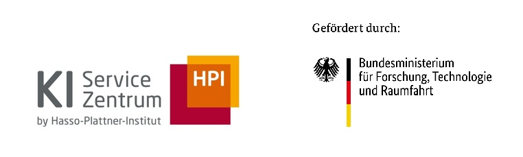
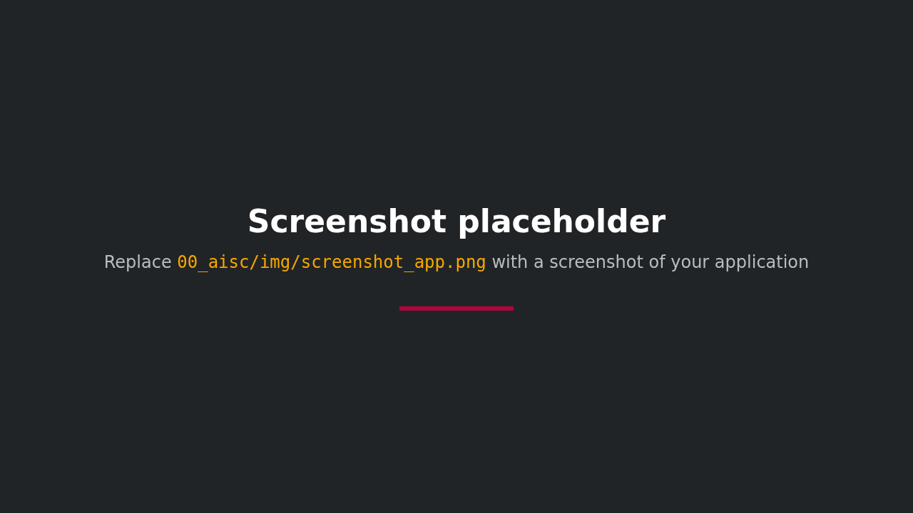

<div style="background-color: #ffffff; color: #000000; padding: 10px;">

<h1>RABBIT Studio</h1>
</div>

RABBIT Studio puts the browser instruments of the musician and teacher [Tom Tiest](https://www.iamarabbit.com/) into one application. Tom built each instrument as a separate web page with an AI chatbot. This repository rebuilds them as one studio in which all instruments follow one shared clock. It is a teaching example for the workshop series [Rapid Prototyping via Vibe Coding](https://github.com/aihpi/workshop-rapid-prototyping).

You do not need to be a programmer to read this page or to help. Technical words are explained in [The words you need](#the-words-you-need).

> **Status: planning. The application is not built yet.** The repository holds the plan, the specifications and Tom's original files. The commands in Quick Start, User Guide and Contributing describe how the application will be used once the first stage of the [build plan](docs/plan.md) is finished. Do not run them today; they will fail.
>
> What you can do today: open the original instruments in `03_originals/` in your browser, read the [build plan](docs/plan.md) (the sections Goal, Scope and Stages), and pick a piece of work as described in [Take on a piece of work](#take-on-a-piece-of-work).



The picture is a placeholder. The last stage of the plan replaces it with a real screenshot.

## Features

The studio will hold six instruments. Each one offers every function of the original files it comes from.

- Beat is a drum machine with five voices, a pattern of 16 steps and loading of your own sounds.
- Synth is a synthesiser with a piano roll, a bass pattern, filter and envelope.
- Slicer cuts an audio file into slices and plays them in random order.
- Theremin turns what the webcam sees into pitch and volume.
- Metronome gives the click, and holds a slot machine for random numbers.
- Console is the mixer, with one channel strip per instrument and per loaded audio file. It exports the mix as a WAV audio file.

All instruments follow one clock, so a tempo change reaches every instrument at once. A project with the settings of all six instruments is saved and loaded by name.

## Setup and Installation

### Prerequisites

You type the commands on this page into a terminal. A terminal is a window in which you write a command and press Enter. On Windows open PowerShell, on macOS open Terminal, on Linux press `Ctrl+Alt+T`.

You need these programs:

- Docker, to run the application. On Windows and macOS the program is called Docker Desktop, and it must be open and running before you type a Docker command.
- Git, to download the code and to send your changes.
- `uv`, only if you want to change the Python code or run the tests.
- A current Chromium, Chrome, Edge or Firefox.

The repository [workshop-getting-started](https://github.com/aihpi/workshop-getting-started) explains how to install Docker, Git and `uv` on Windows, macOS and Linux. No graphics card is needed.

To check that the programs are installed, run these two commands. Each must print a version number.

```bash
docker --version
```
```bash
git --version
```

### Quick Start

This works from stage 0 of the build plan on. See the status at the top.

1. Download the code and go into its folder. Type each line and press Enter:
   ```bash
   git clone https://github.com/aihpi/demo-rabbit-studio.git
   ```
   ```bash
   cd demo-rabbit-studio
   ```

2. Build and start the application. The first run downloads what it needs and takes a few minutes:
   ```bash
   docker compose up --build
   ```
   The terminal now stays busy and prints messages. This is correct. Leave it open.

3. Open your browser and go to http://localhost:8080. `localhost` means your own computer; nothing is sent to the internet. You are done when you see the studio. As a second check, http://localhost:8080/api/health must show `{"status": "ok"}`.

4. To stop the application, click into the terminal and press `Ctrl+C`. Saved projects are kept.

If it does not work:

| What you see | What to do |
|---|---|
| `Cannot connect to the Docker daemon` | Docker is not running. Start Docker Desktop, wait until it is ready, and repeat step 2. |
| `port is already allocated` | Another program uses port 8080. Close it, or stop an earlier run with `docker compose down`, and repeat step 2. |
| The browser shows an empty page or an error | Wait until the terminal stops printing new lines, then reload the page. If it stays empty, copy the last lines of the terminal into a new issue (see [Issues and the project board](#issues-and-the-project-board)). |

## User Guide

This describes the planned application. It is updated when the application exists.

### Using the Tool

1. Press start in the header. Browsers allow sound only after a click on the page.
2. Open a tab, for example Beat, and switch the instrument on with the switch on its tab.
3. Set a pattern. Change the tempo in the header and hear every instrument follow.
4. Open the Console tab to set the level, the position between left and right, and the reverb of each instrument.
5. Save the project under a name. Load it again after a restart.

### Recommendations

Use headphones or loudspeakers; laptop loudspeakers hide the bass. Allow the camera only for the Theremin tab. The Theremin works only when you open the studio as `http://localhost:8080` on the computer that runs it.

To hear the difference to the original approach, open two files from `03_originals/` in two browser windows, start both and change the tempo in one of them. This works today.

## How the project works

### The words you need

| Word | Meaning here |
|---|---|
| Terminal | A window in which you type commands. See Prerequisites. |
| Repository | The folder with all files of this project and their history. It lives on GitHub, and you download a copy. |
| Frontend | The files that the browser loads and shows: the page, its look and the instruments. Folder `01_frontend/`. |
| Backend | A program that runs on the computer, not in the browser. It hands the frontend files to the browser and stores projects and audio files. Folder `02_backend/`. |
| API | The list of addresses through which the frontend talks to the backend, for example `/api/projects`. |
| localhost | The name of your own computer, as seen from your own browser. |
| Docker | A tool that packs a program with everything it needs into one package, called an image. |
| Container | A running copy of an image. It behaves the same on every computer. |
| `docker compose` | A command that reads the file `docker-compose.yml` and starts the container with the right settings. |
| Volume | A storage place that Docker keeps when the container stops. Projects and audio files live there. |
| Python | The programming language of the backend. |
| `uv` | A tool that installs the Python packages of the backend and runs commands with them. It replaces `pip`. |
| FastAPI, SQLite | FastAPI is the Python package that the backend is written with. SQLite is a database in a single file. |
| Web Audio API | The part of the browser that makes sound. Tom's files use it, and so does the studio. |
| Transport | The part of the studio that keeps time: start, stop, tempo and swing. |
| Channel strip | One column of a mixer: level, left or right position, tone and effects for one sound source. |
| WAV | A common format for audio files. |
| Template | The starting files that every repository of the `aihpi` organisation is copied from. |
| Stage | One step of the build plan. Each stage adds one thing. |
| Specification | A document that says exactly what one part of the studio must do. Folder `docs/modules/`. |
| Parity table | The table in a specification that lists every function of the original file and where it is in the studio. |
| Git | The program that records every change to the files and sends changes to GitHub. |
| Branch | Your own line of changes, separate from the main version until it is accepted. |
| Commit | One recorded change with a short message. |
| Fork | Your own copy of the repository on GitHub. You need it if you are not a member of the `aihpi` organisation. |
| Pull request | Your request to take the changes of your branch into the main version. Somebody reviews it first. |
| Issue | A note on GitHub that describes a task, a defect or a question. |
| Test | A small program that checks automatically that a part still works. |
| `pytest`, `ruff`, Playwright | `pytest` runs the tests. `ruff` checks and tidies Python code. Playwright lets a test use a real browser. |

### What is where

```
demo-rabbit-studio/
├── 00_aisc/                logos of the AI Service Centre
├── 01_frontend/            what the browser loads; plain HTML, CSS and JavaScript
├── 02_backend/             the Python server, its tests and its Dockerfile
├── 03_originals/           Tom Tiest's eight HTML files and his prompts, unchanged
├── docs/plan.md            the build plan with all decisions and stages
├── docs/inventory.md       what the original files do
├── docs/modules/           one specification per part of the studio
├── docs/open-questions.md  what is still undecided
├── CHANGELOG.md            what changed, including each fixed defect of the originals
└── docker-compose.yml      how the container starts
```

The frontend has no build step. A file in `01_frontend/` is the file the browser gets. Each instrument is one folder, for example `01_frontend/instruments/beat/`. All instruments use the same knob, the same meter and the same reverb from the folders `ui/` and `fx/`.

### How the parts talk to each other

One transport counts the steps. At each step it tells every instrument that is switched on which step to play and at which exact time. Each instrument sends its sound to its own channel strip, and the mixer sends the sum to the loudspeakers. When you save, the frontend sends the project to the backend, and the backend writes it into a database file.

The [build plan](docs/plan.md) has the diagram and ten rules that keep this structure, for example "there is one clock" and "reverb exists once". Its section Architecture is written for the person who builds a stage; you can skip it on a first read.

## Contributing

All of this works from stage 0 of the build plan on, except [Take on a piece of work](#take-on-a-piece-of-work), which works today.

### Change the look or an instrument

1. Start the application as in Quick Start and leave it running.
2. Open a file in `01_frontend/` in any text editor, for example the free editor Visual Studio Code. As a first try, open `01_frontend/styles/tokens.css` and change the value after `--accent` to another colour.
3. Save the file and reload the page in the browser. The red parts of the studio now have your colour. You do not need to restart anything.

### Change the backend

1. Stop the container with `Ctrl+C` if it runs.
2. Go into the backend folder and install the Python packages. This is needed once. At the end `uv` prints the list of installed packages:
   ```bash
   cd 02_backend
   ```
   ```bash
   uv sync
   ```
3. Start the backend without Docker. It restarts by itself when you save a Python file. You are done when the terminal prints a line with `Uvicorn running`:
   ```bash
   uv run uvicorn app.main:app --reload --port 8000
   ```
4. Open http://localhost:8000 in the browser.
5. To add a Python package, use `uv add <package>`. Do not use `pip install`.

### Check your change

Do this for every change, also when you only changed the frontend, because the tests include the instruments. Run the commands in the folder `02_backend/`. The application does not need to be running.

1. Once per computer, install the browser for the tests:
   ```bash
   uv run playwright install chromium
   ```
2. Check the Python code. The last line must be `All checks passed!`:
   ```bash
   uv run ruff check .
   ```
3. Tidy the Python code:
   ```bash
   uv run ruff format .
   ```
4. Run the tests. The last line must say `passed` and must not say `failed`:
   ```bash
   uv run pytest
   ```

If a check or a test fails, read the lines above the last one: they name the file and the line. If you cannot solve it, open the pull request anyway and say so in its description. Somebody will help.

### Take on a piece of work

1. Read [docs/plan.md](docs/plan.md). The table of stages has a column Status that shows what is open. Stages 4 to 8 are one instrument each and suit a first contribution.
2. Read the specification of that part in [docs/modules/](docs/modules/). Its parity table lists every function the part must have. Its last sections list the tests and the open questions. Questions marked for the owner in [docs/open-questions.md](docs/open-questions.md) must be answered before you start; ask in the issue.
3. Look at the [list of issues](https://github.com/aihpi/demo-rabbit-studio/issues). If there is an issue for your piece of work, write a comment that you take it. If there is none, create one with [New issue](https://github.com/aihpi/demo-rabbit-studio/issues/new/choose) and the template Task.
4. If you are not a member of the `aihpi` organisation, press Fork at the top right of the repository page and clone your fork instead of the original.
5. Create a branch. Give it a short name that says what you do, for example `beat-pads`:
   ```bash
   git switch -c beat-pads
   ```
6. Make your change and check it as described above.
7. Record the change and send it to GitHub:
   ```bash
   git add .
   ```
   ```bash
   git commit -m "Add the step pads of the Beat module"
   ```
   ```bash
   git push -u origin beat-pads
   ```
8. Open the repository page on GitHub. A yellow bar offers the button "Compare & pull request". Press it, describe what you changed and how you checked it, and create the pull request. One pull request adds one thing.
9. If you fixed a defect of an original file, add one line to `CHANGELOG.md` with the file and the line.

If the specification and the original file disagree, open the original in `03_originals/` in your browser and trust what you see and hear. Then correct the specification in the same pull request.

## Limitations

- The repository holds no application code yet. See the status at the top.
- The studio runs on one computer. It does not synchronise several computers over the network.
- The specifications come from reading the source code of the original files. Nobody ran the originals to confirm each described behaviour.
- The Theremin needs a camera, works only on `http://localhost`, and is not part of the WAV export.
- The layout needs a screen that is at least 640 pixels wide.

## References

- [Tom Tiest, I Am A Rabbit](https://www.iamarabbit.com/)
- [Workshop Rapid Prototyping via Vibe Coding](https://github.com/aihpi/workshop-rapid-prototyping)
- [Web Audio API on MDN](https://developer.mozilla.org/en-US/docs/Web/API/Web_Audio_API)
- [FastAPI](https://fastapi.tiangolo.com/)
- [uv](https://docs.astral.sh/uv/)
- [Docker Compose](https://docs.docker.com/compose/)

## Author

- [Hanno Müller](https://hpi.de/kisz)
- Instruments and design by [Tom Tiest](https://www.iamarabbit.com/)

## Issues and the project board

Found a defect, have a question or want to take a task? Open the [list of issues](https://github.com/aihpi/demo-rabbit-studio/issues) or create a [new issue](https://github.com/aihpi/demo-rabbit-studio/issues/new/choose) with one of the templates. Every new issue appears on the [AIHPI project board](https://github.com/orgs/aihpi/projects/3).

Note for maintainers: `.github/workflows/add-issue-to-project.yml` adds the issue to the board. It needs a token in the secret `ADD_ISSUE_TO_PROJECT`, because the workflow's own `GITHUB_TOKEN` cannot write to organisation projects. This repository is public, so it inherits the organisation-level secret and nothing needs to be set.

## License

This project is licensed under the MIT License. See [LICENSE](LICENSE).

---

## Acknowledgements


The [AI Service Centre Berlin Brandenburg](http://hpi.de/kisz) is funded by the [Federal Ministry of Research, Technology and Space](https://www.bmbf.de/) under the funding code 16IS22092.
